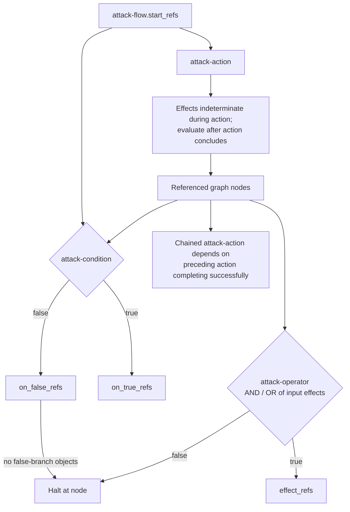

Protocol is **not applicable**. Attack Flow v4.1.0 defines a STIX 2.1 JSON
graph data format, using extension version 2.0.0. Its objects describe adversary
behavior and the relationships among actions, conditions, operators, and assets.
The inspected language, extension definition, and normative schema define no
roles exchanging messages, transport, endpoints, request/response sequence, or
protocol error path. This is an applicability finding derived from the source's
scope, rather than a quoted normative requirement.

The source identifies itself as a machine-readable STIX extension and names its
JSON Schema as the formal language specification ([`docs/language.rst`,
Overview, lines 7–24](https://github.com/center-for-threat-informed-defense/attack-flow/blob/v4.1.0/docs/language.rst#L7-L24)).
The extension definition declares `extension_types: ["new-sdo"]` and version
`2.0.0` ([`stix/attack-flow-extension-2.0.0.json`,
`/objects/0/version` and `/objects/0/extension_types`](https://github.com/center-for-threat-informed-defense/attack-flow/blob/v4.1.0/stix/attack-flow-extension-2.0.0.json)).
The normative schema describes additional STIX objects that model Attack Flow
concepts ([`stix/attack-flow-schema-2.0.0.json`, `/description` and
`/$defs`](https://github.com/center-for-threat-informed-defense/attack-flow/blob/v4.1.0/stix/attack-flow-schema-2.0.0.json)).

An object's `created_by_ref` records its creator; it does not establish a
protocol participant. The extension's `schema` URL locates a schema; it does not
specify an exchange endpoint. See [`docs/language.rst`, STIX Common Properties /
`created_by_ref`, lines 84–87](https://github.com/center-for-threat-informed-defense/attack-flow/blob/v4.1.0/docs/language.rst#L84-L87),
and [`stix/attack-flow-extension-2.0.0.json`,
`/objects/0/schema`](https://github.com/center-for-threat-informed-defense/attack-flow/blob/v4.1.0/stix/attack-flow-extension-2.0.0.json).

The word *flow* concerns graph semantics. `attack-flow.start_refs` names the
starting action or condition objects. Action effects remain indeterminate while
an action executes; a directly chained action depends on the preceding action
completing successfully. A condition selects its true or false references. An
AND or OR operator joins input effects, continues to its effects when true, and
halts when false. Technique failure and graph halting are modeled behavior,
with no corresponding transport error or recovery exchange. See
[`docs/language.rst`, Attack Flow / `start_refs`, lines 162–165](https://github.com/center-for-threat-informed-defense/attack-flow/blob/v4.1.0/docs/language.rst#L162-L165),
[Attack Condition / branch fields, lines 395–401](https://github.com/center-for-threat-informed-defense/attack-flow/blob/v4.1.0/docs/language.rst#L395-L401),
[Attack Operator / operator and effects, lines 445–454](https://github.com/center-for-threat-informed-defense/attack-flow/blob/v4.1.0/docs/language.rst#L445-L454),
and [Effects, lines 600–615](https://github.com/center-for-threat-informed-defense/attack-flow/blob/v4.1.0/docs/language.rst#L600-L615).

The following diagram depicts the available graph relationships; a document
need not contain every depicted node or edge. Its nodes are data objects and
evaluation outcomes, not communicating participants. It does not introduce a
scheduling service or prescribe an execution implementation.



`protocol.yaml` therefore leaves `roles`, `messages`, `flows`, and `error_paths`
empty and records the graph semantics separately. No protocol sequence diagram
is applicable because the source specifies no exchange among participants.

The record's `distillation.not_applicable` entry should use this reason:

```yaml
- kind: protocol
  reason: >-
    Pure STIX 2.1 JSON graph data format; the source defines objects and graph
    evaluation semantics, but no roles exchanging messages, transport,
    endpoints, request/response sequences, or protocol error paths. See
    docs/language.rst, Overview, Attack Flow SDOs, and Effects;
    stix/attack-flow-extension-2.0.0.json, /objects/0/extension_types; and
    stix/attack-flow-schema-2.0.0.json, /description and /$defs.
```
